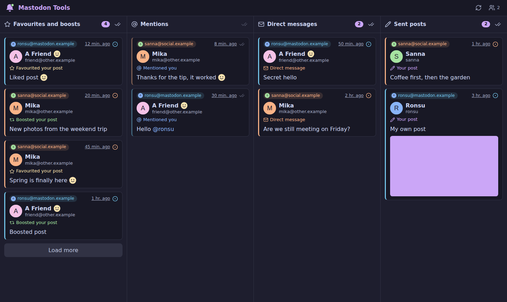

# Mastodon Tools (MAST)

MAST is a dashboard-style web app for following several Mastodon accounts at once. It runs in the browser and installs as a PWA. There is no backend: the app talks directly to your Mastodon servers using the official [Mastodon client API](https://docs.joinmastodon.org/client/intro/).

The screenshots are made from mock data, not from real accounts.

## Features

The view has four columns (tabs on a narrow screen). Each one combines all connected accounts in time order:

* Favourites and boosts
* Mentions
* Direct messages, shown as conversations
* Posts sent by your accounts

Accounts can be on different servers and are managed behind the people icon in the top right corner. Every account has its own color, shown on the cards, so you see which account an item concerns. Each column shows how many items are unread and has a mark as read button. The read state is kept in the browser (local storage), because the Mastodon API has no per-notification read state for this use.

The first version is read only. Custom emojis are shown as images. Dark theme only ([Catppuccin Mocha](https://catppuccin.com/palette/)). UI languages are Finnish and English.

## How it works

* Login uses OAuth 2 authorization code flow with PKCE. The app registers itself on each server with `POST /api/v1/apps`, so any server works. Mastodon only provisions confidential clients, so the client secret it returns is stored in the browser together with the access token. PKCE needs Mastodon 4.3 or newer.
* Notifications: `GET /api/v1/notifications` filtered by type. Direct messages: `GET /api/v1/conversations`. Own posts: `GET /api/v1/accounts/:id/statuses`.
* The columns are refreshed every 5 minutes while the page is visible, and with the refresh button. There is no live streaming: it would keep a connection open to every server. Mastodon allows 300 requests per 5 minutes per account and per IP, and an account that hits the limit is left alone until it resets.
* Tokens and cached data stay in the browser. Nothing is sent to any server other than your own Mastodon servers.
* Web Push is not supported, because it needs a server component. Notifications are shown while the app is open.

### OAuth scopes

`read:accounts read:notifications read:statuses`. If the scopes change in a later version, the app asks you to log in again.

## Tech stack

Svelte 5, Vite and TypeScript. The build is a static site in `public/`. PWA support through `vite-plugin-pwa`. Tests: Vitest and Playwright (the Mastodon API is mocked).

## Development

    npm ci
    npm run dev
    npm run check
    npm test
    npm run build
    npm run test:e2e

Run `npm run build` before `npm run test:e2e`, because the browser tests use the build in `public/`. The first time, install the test browser with `npx playwright install chromium`. The browser tests answer the Mastodon API from a mock (`e2e/mock.ts`), also on a phone profile. To update the screenshots above: `SCREENSHOTS=1 npx playwright test screenshots --project desktop`.

## Deployment

Serve the `public/` directory as a static site over HTTPS (required for a PWA), with fallback to `index.html`. Example Content Security Policy header (must equal the `<meta>` tag in `index.html`):

    Content-Security-Policy: default-src 'none'; script-src 'self'; style-src 'self'; img-src 'self' https: data:; media-src https:; connect-src https:; manifest-src 'self'; worker-src 'self'; base-uri 'none'; form-action 'none'

To update:

    git fetch
    git checkout vx.y.z
    npm ci
    npm run build

### Caching

The files in `assets/` have a content hash in their name, so a new build always gets new names and they can be cached for a long time (`Cache-Control: public, max-age=31536000, immutable`). The files without a hash must not be cached without checking: `index.html`, `sw.js`, `registerSW.js` and `manifest.webmanifest` should have `Cache-Control: no-cache`. The service worker updates itself and the page reloads when a new version is available.

## License

MIT, see [LICENSE](LICENSE).
